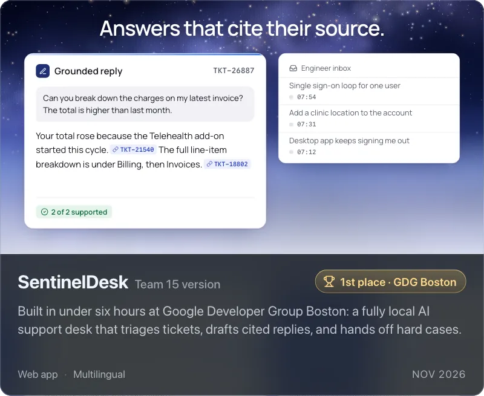
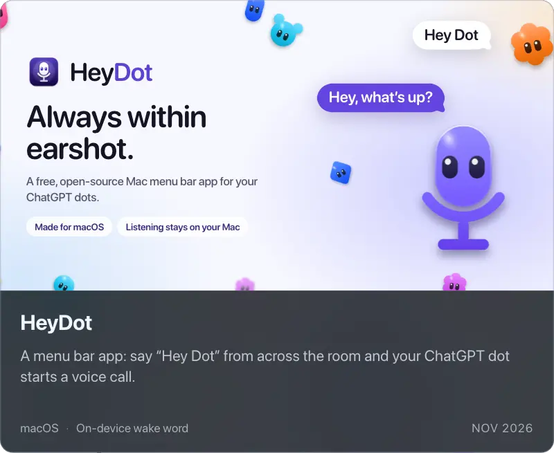

I'm a builder and product engineer working across AI, fintech, and web technology. In my work, I am particular about how things feel to use, especially the small details. Lately, my focus has been on personal AI, LLM orchestration, and tools that change how we build software and interact with our computers. Outside of software, I'm a musician and producer.

  &nbsp;&nbsp;&nbsp;

